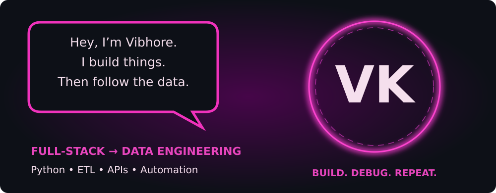
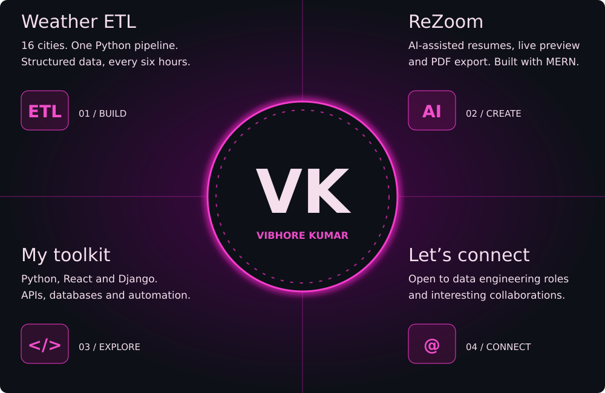

  <a href="https://linkedin.com/in/vibhore-kumar-9b9298376"><picture><source media="(prefers-color-scheme: light)" srcset="./assets/nav-linkedin-light.svg" /></picture></a>
  <a href="mailto:vibhore098sharma@gmail.com"><picture><source media="(prefers-color-scheme: light)" srcset="./assets/nav-email-light.svg" /></picture></a>
  <a href="https://github.com/VibhoreKumar"><picture><source media="(prefers-color-scheme: light)" srcset="./assets/nav-vk-light.svg" /></picture></a>
  <a href="https://leetcode.com/u/8ZHi5hqRLR"><picture><source media="(prefers-color-scheme: light)" srcset="./assets/nav-leetcode-light.svg" /></picture></a>
  <a href="https://github.com/VibhoreKumar?tab=repositories"><picture><source media="(prefers-color-scheme: light)" srcset="./assets/nav-github-light.svg" /></picture></a>

<picture><source media="(prefers-color-scheme: light)" srcset="./assets/neon-hero-light.svg" /></picture>

<picture><source media="(prefers-color-scheme: light)" srcset="./assets/neon-work-light.svg" /></picture>

  <a href="https://github.com/VibhoreKumar/mini_weather_ETL_pipeline">Explore Weather ETL ↗</a> &nbsp; · &nbsp;
  <a href="https://github.com/VibhoreKumar?tab=repositories">Browse my projects ↗</a> &nbsp; · &nbsp;
  <a href="mailto:vibhore098sharma@gmail.com">Let’s connect ↗</a>

<b>Behind the glow — about me, projects & experience</b>

## About me

I'm **Vibhore Kumar**, a Computer Science Engineering student at **GD Goenka University (2027)**. I started in full-stack development and am building toward **data engineering**, learning through Python pipelines, API integration and automation.

## Selected projects

- **[Weather ETL Pipeline](https://github.com/VibhoreKumar/mini_weather_ETL_pipeline)** — Python’s standard library, Open-Meteo data for 16 cities, JSON Lines, logging and a GitHub Actions schedule configured for every six hours.
- **ReZoom / AI Resume Builder** — team-built MERN application with AI suggestions, editable templates, JWT authentication, live preview and PDF export.
- **Loan Origination System** — React and Django internship work on loan processing workflows, reusable UI components and REST APIs.
- **[WebArclight 24×7](https://paleturquoise-kudu-295653.hostingersite.com/index.php)** — frontend contributions using PHP, JavaScript, HTML and CSS.

## Toolkit

| Focus | Technologies |
| :--- | :--- |
| Data | Python, JSON, SQLite, MySQL, ETL, logging |
| Frontend | React, JavaScript, HTML, CSS, Tailwind CSS |
| Backend | Node.js, Express, Django, REST APIs, MongoDB |
| Workflow | Git, GitHub, GitHub Actions, Postman, VS Code |

## Experience

**Full-Stack Developer Intern · WebArclight**  
October 2025 – January 2026  
React and Django applications, reusable components, REST API integration and team collaboration.

**Web Development Intern · UptoSkills**  
July – September 2025  
Frontend and backend contributions with the MERN stack, working with mentors and teammates.

## Beyond code

U-19 state cricketer, representing Kota, Rajasthan (2020) · 100+ DSA problems across LeetCode and GeeksforGeeks · Python Essentials certification.

[GeeksforGeeks](https://geeksforgeeks.org/profile/vibhore092k0l) · [LeetCode](https://leetcode.com/u/8ZHi5hqRLR) · [LinkedIn](https://linkedin.com/in/vibhore-kumar-9b9298376)

Learning in public · Building one system at a time · India

