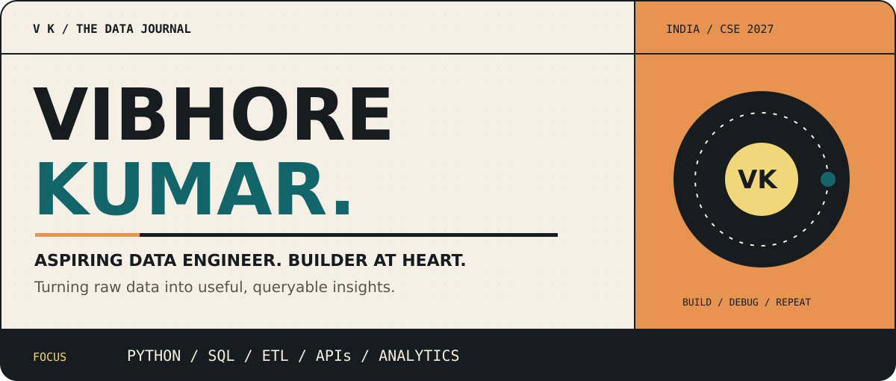
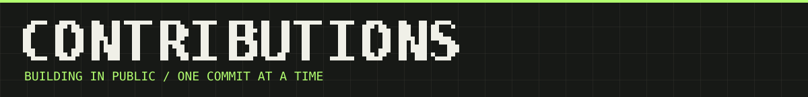
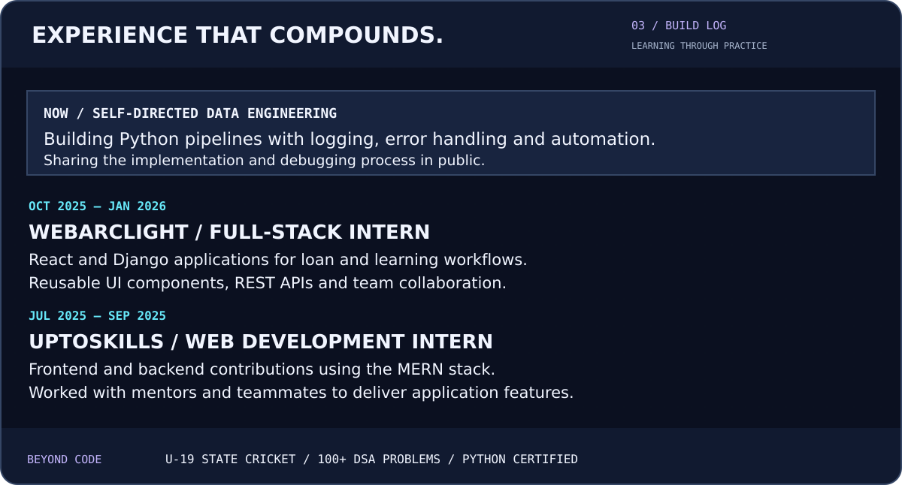
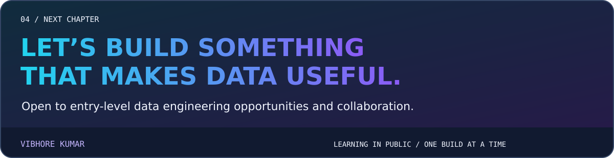

<!-- Holopin badge board -->

  

<!-- Upload README.md and the assets folder together to VibhoreKumar/VibhoreKumar. -->

  

  
  
  
  

 

  

  
  

 

<b>Read the notes — accessible text version</b>

### About
I'm **Vibhore Kumar**, a CSE student at **GD Goenka University (2027)**, moving from full-stack development into **data engineering**. I build Python ETL pipelines, integrate APIs and automate workflows while documenting what I learn.

### Toolkit
| Area | Tools |
| --- | --- |
| Data | Python, JSON, SQLite, MySQL, ETL, logging |
| Frontend | React, JavaScript, HTML, CSS, Tailwind CSS |
| Backend | Node.js, Express, Django, REST APIs, MongoDB |
| Workflow | Git, GitHub, GitHub Actions, Postman, VS Code |

### Selected work
- **[Weather ETL](https://github.com/VibhoreKumar/mini_weather_ETL_pipeline):** pulls weather data for 16 cities, classifies readings and writes JSON Lines; configured to run every six hours with GitHub Actions. Built using Python's standard library.
- **AI Resume Builder:** team project with AI suggestions, editable templates, JWT authentication, live preview and PDF export.
- **Loan Origination System:** React and Django internship work on loan processing workflows and API integration.
- **[WebArclight 24×7](https://paleturquoise-kudu-295653.hostingersite.com/index.php):** frontend contributions using PHP, JavaScript, HTML and CSS.

### Experience
- **WebArclight — Full-Stack Developer Intern · Oct 2025–Jan 2026:** React and Django applications, reusable UI components and REST APIs.
- **UptoSkills — Web Development Intern · Jul–Sep 2025:** frontend and backend contributions with the MERN stack.
- **Self-directed data engineering:** Python pipelines, logging, error handling and GitHub Actions automation.

### Beyond code
U-19 state cricket, representing Kota, Rajasthan (2020) · 100+ DSA problems across LeetCode and GeeksforGeeks · Python Essentials certification.

 

  
  

Learning in public · Building one system at a time · India

