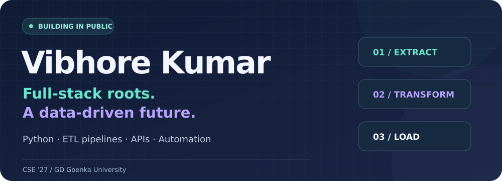

  

  <a href="https://linkedin.com/in/vibhore-kumar-9b9298376">LinkedIn</a> &nbsp; · &nbsp;
  <a href="mailto:vibhore098sharma@gmail.com">Email</a> &nbsp; · &nbsp;
  <a href="https://leetcode.com/u/8ZHi5hqRLR">LeetCode</a> &nbsp; · &nbsp;
  <a href="https://geeksforgeeks.org/profile/vibhore092k0l">GeeksforGeeks</a>

<b>Learning how data moves, how systems work, and how to make both reliable.</b>

## A little about me

I'm **Vibhore Kumar**, a Computer Science Engineering student at **GD Goenka University, class of 2027**. I started with full-stack development and am now building toward **data engineering**.

Working with APIs and databases made me curious about what happens behind the interface. Today, I’m turning that curiosity into Python pipelines, automated workflows and practical projects.

- **Building:** ETL pipelines with Python’s standard library.
- **Practising:** API integration, logging, error handling and automation.
- **Sharing:** what I build, what breaks, and what I learn along the way.
- **Looking for:** entry-level data engineering opportunities and collaboration.

## Selected projects

### 01 / Weather ETL Pipeline

**Python · JSON Lines · GitHub Actions · Logging**

Extracts weather data for **16 cities** from Open-Meteo, classifies readings and appends structured records. Configured to run **every six hours** with GitHub Actions.

The most useful lessons came from fixing import side effects, malformed input and workflow permissions.

**[Explore the code ↗](https://github.com/VibhoreKumar/mini_weather_ETL_pipeline)**

---

### 02 / AI Resume Builder

**MongoDB · Express · React · Node.js · JWT**

A team-built resume builder with AI content suggestions, editable templates, authentication, live preview and PDF export.

### 03 / Loan Origination System

**React · Django · Python · REST APIs**

Internship work on loan processing workflows, reusable interface components and backend integration.

### 04 / WebArclight 24×7

**PHP · JavaScript · HTML · CSS**

Contributed frontend components and responsive interfaces as part of the development team.

**[Visit the website ↗](https://paleturquoise-kudu-295653.hostingersite.com/index.php)**

## My toolkit

| Focus | Technologies |
| :--- | :--- |
| **Data** | Python, JSON, SQLite, MySQL, ETL, logging |
| **Frontend** | React, JavaScript, HTML, CSS, Tailwind CSS |
| **Backend** | Node.js, Express, Django, REST APIs, MongoDB |
| **Workflow** | Git, GitHub, GitHub Actions, Postman, VS Code |

## Experience

**Full-Stack Developer Intern · WebArclight**  
*October 2025 – January 2026*

Worked on React and Django applications, including loan and learning workflows. Built reusable components, integrated REST APIs and collaborated with the development team.

**Web Development Intern · UptoSkills**  
*July – September 2025*

Contributed to frontend and backend features using the MERN stack, working with mentors and teammates.

## Away from the editor

🏏 **U-19 state cricketer** — represented Kota, Rajasthan (2020)  
🧩 **100+ DSA problems** — LeetCode and GeeksforGeeks  
📜 **Python Essentials certification**

---

  <b>Have a project where data meets a real problem?</b> 
  <a href="mailto:vibhore098sharma@gmail.com">Let’s talk</a> ·
  <a href="https://github.com/VibhoreKumar?tab=repositories">Explore my repositories</a>

Learning in public. Building one system at a time.

